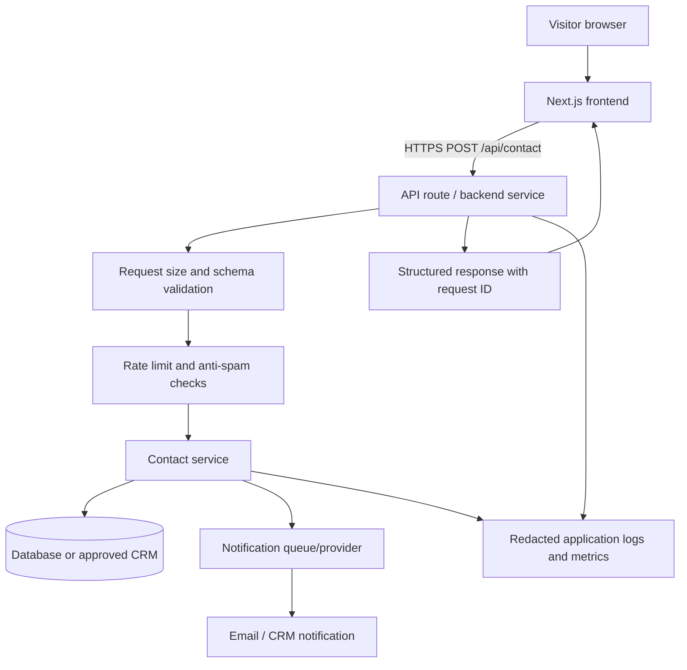

# Proposed Reference Architecture

This is a generic recommended architecture for a public contact form. It is **not** a diagram of Cynbit's confirmed internal systems.

## Design principles
1. Keep the browser-facing contract small and stable.
2. Validate all inputs on the server.
3. Apply abuse controls before expensive processing.
4. Store only necessary personal information.
5. Use asynchronous notification delivery where appropriate.
6. Return generic client errors and retain detailed diagnostics server-side.
7. Track requests with correlation IDs.
8. Keep private data and user-specific responses out of shared caches.
